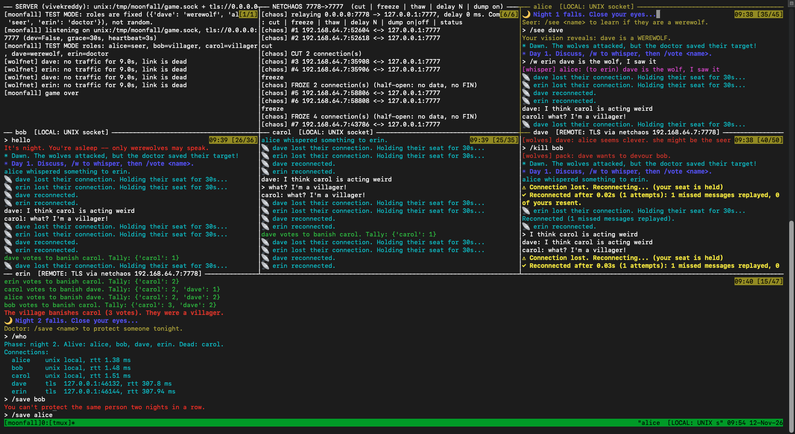
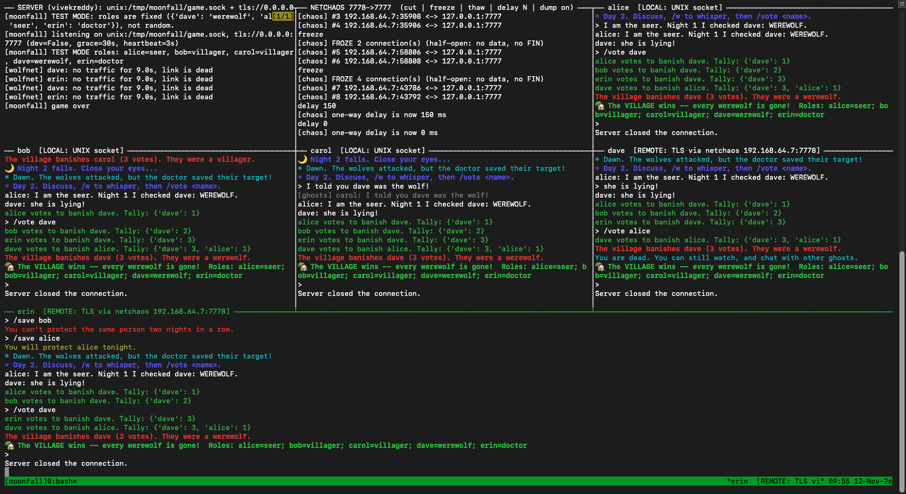
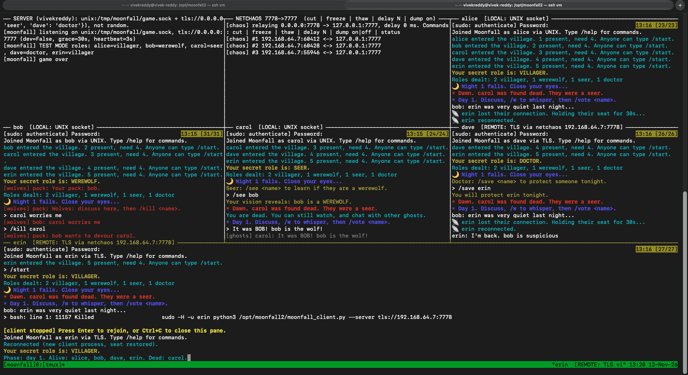
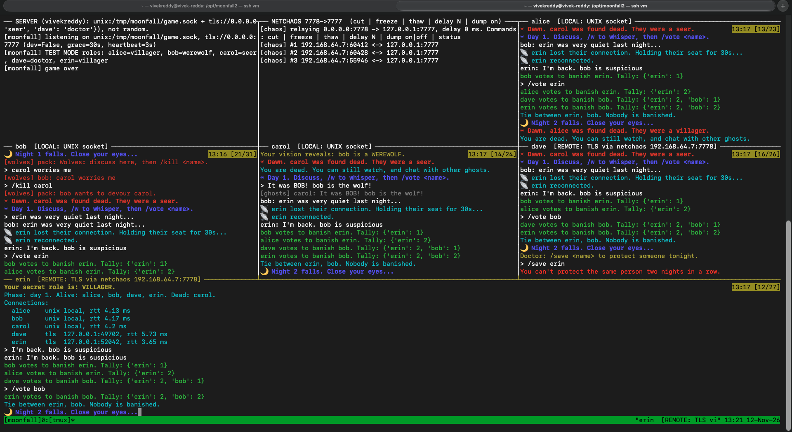

<<<<<<< HEAD
# 🌕 Moonfall 2: a *distributed* Werewolves-like game

Moonfall 2 is the Project #2/#3 version of my Project #1 game, [Moonfall](https://github.com/vivekreddy1105/moonfall).
Project 1 ran on **one machine** over UNIX domain sockets. Moonfall 2 is a **distributed
system**: players can now join from **other machines** over **TCP + mutual TLS 1.3**, and the
game survives network failures (dropped connections, half-open links, crashed clients)
without losing or duplicating a single message.

> **Communications library:** **`wolfnet.py`**, a single file at the top level of this repo.
> Every byte the server, clients and bots exchange goes through it.
> See [its API](#-the-communications-library-wolfnetpy).
>
> **Classmates: please try to break it!** See [Try to break it](#-try-to-break-it-feedback-wanted).


*Seven tmux panes: the server, the "bad network" simulator, three **local** players (UNIX socket),
and two **remote** players (TLS). Every player is a different Linux user.*

---

## 🆕 What changed since Project 1

| | Project 1 | Moonfall 2 (Projects 2/3) |
|---|---|---|
| Where players can be | same machine only | same machine **or any other machine** |
| Transport | UNIX domain stream socket | UNIX socket **and** TCP + **TLS 1.3**, at the same time |
| Who you are | kernel `SO_PEERCRED` (your UID) | `SO_PEERCRED` locally; a **client certificate** signed by the game's own CA remotely |
| Eavesdropping | not possible (local socket) | network traffic is encrypted (TLS) |
| Connection drops | player "fled" immediately | seat held for 30 s; the client **reconnects automatically** |
| Lost messages on reconnect | n/a | **exactly-once, in-order** delivery both ways (sequence numbers, replay, resend) |
| Dead link with no error (half-open TCP) | n/a | **heartbeats** detect it in 3 missed beats (≈9 s) |
| Client crash | player gone | restart within 30 s and you get your seat **and your role** back |
| Terminal escape codes in chat | relayed raw (bug!) | stripped by the server (and by the client) |

The game rules and the library API are unchanged, so `moonfall_server.py` can't tell whether a
player is local or remote.

---

## 🎭 The game

A moderator server secretly deals roles to 4 or more players:

| Role | Goal | Night action |
|---|---|---|
| 🐺 **Werewolf** (1 per 4 players) | Eliminate villagers until wolves equal or outnumber them | `/kill <name>`, chosen with the pack in a private wolf chat |
| 🔮 **Seer** | Find the wolves | `/see <name>`, once per night, to learn if that player is a werewolf |
| 💉 **Doctor** (5+ players) | Keep people alive | `/save <name>`, but not the same person two nights in a row |
| 🧑 **Villager** | Find the wolves | None: talk, reason, and vote |

**🌙 Night:** only wolves can speak, in their pack channel. The seer and doctor act secretly.

**☀ Day:** everyone talks, can `/w` whisper, and votes with `/vote`.
- The tally is public and live.
- A tie banishes nobody.
- Everyone sees *that* you whispered, but not *what* you said.

**💀 Dead players** watch, and can talk to each other in a private ghosts channel.

**Win conditions:** the village wins when every wolf is dead. The wolves win when they equal or
outnumber the rest.

**Phase length:** a phase ends as soon as everyone has acted, or after 5 minutes (night) or
10 minutes (day).

---

## 🚀 Quick start

**Requirements:** Ubuntu (tested on 26.04), **Python 3.11+**, `tmux` and `openssl`. There are no
pip packages and nothing to compile.

### Option A: the full demo (multi-user, local + remote players)
```bash
git clone https://github.com/vivekreddy1105/moonfall2.git
sudo cp -r moonfall2 /opt/moonfall2 && sudo chmod -R a+rX /opt/moonfall2   # home dirs are private on Ubuntu
cd /opt/moonfall2
sudo ./setup_users.sh       # users alice..erin, the 'moonfall' group, and a TLS certificate for each
./play_tmux.sh              # maximize your terminal first: 7 panes
=======
# Moonfall 2: a distributed Werewolves-like game

This is the Project #2/#3 version of my Project #1 game,
[Moonfall](https://github.com/vivekreddy1105/moonfall).

Project 1 ran on one machine over UNIX domain sockets. Moonfall 2 lets players join from other
machines over TCP with mutual TLS 1.3. The game also keeps working through network problems,
such as dropped connections, silent (half-open) links and crashed clients, without losing or
duplicating any message.

**Communications library:** `wolfnet.py`, a single file at the top level of this repo. All
communication between the server, clients and bots goes through it.

**Feedback wanted:** please see [Try to break it](#try-to-break-it) at the end.


The panes are: the server, a network simulator, three local players (UNIX socket) and two
remote players (TLS). Each player is a different Linux user.

## What changed since Project 1

| | Project 1 | Moonfall 2 |
|---|---|---|
| Where players can be | same machine | same machine or another machine |
| Transport | UNIX socket | UNIX socket and TCP + TLS 1.3, at the same time |
| Identity | `SO_PEERCRED` (Linux user) | `SO_PEERCRED` locally; a client certificate signed by the game's CA remotely |
| Connection drops | player leaves the game | seat held for 30 s while the client reconnects automatically |
| Messages during a reconnect | n/a | delivered exactly once and in order, in both directions |
| Silent dead link | n/a | detected by heartbeats after about 9 s |
| Client crash | player gone | restart within 30 s to get the seat and role back |
| Terminal escape codes in chat | passed through (bug) | removed by the server |

The game logic doesn't know whether a player is local or remote.

## The game

The server deals secret roles to 4 or more players:

| Role | Night action |
|---|---|
| Werewolf (1 per 4 players) | `/kill <name>`, agreed with the other wolves in a private chat |
| Seer | `/see <name>` to learn whether that player is a werewolf |
| Doctor (5+ players) | `/save <name>`, but not the same person two nights in a row |
| Villager | none |

- **Night:** only werewolves can talk, in their private channel.
- **Day:** everyone talks, can whisper with `/w`, and votes with `/vote`. The most votes is
  banished; a tie banishes nobody. Others can see that a whisper happened, but not what it said.
- **Dead players** can only talk to other dead players.
- **Who wins:** the village wins when all werewolves are dead. The werewolves win when they
  equal or outnumber everyone else.
- **Phase length:** a phase ends when everyone has acted, or after 5 minutes (night) or
  10 minutes (day).

## Setup

**Requirements:** Ubuntu (tested on 26.04), Python 3.11+, `tmux` and `openssl`. There are no
packages to install.

### Full game (several Linux users, local and remote players)
```bash
git clone https://github.com/vivekreddy1105/moonfall2.git
sudo cp -r moonfall2 /opt/moonfall2 && sudo chmod -R a+rX /opt/moonfall2
cd /opt/moonfall2
sudo ./setup_users.sh       # creates users alice..erin and a certificate for each
./play_tmux.sh
>>>>>>> b84e090 (Moonfall 2: distributed Werewolves-like game (UNIX sockets + mutual TLS))
```
Once everyone has joined, type `/start` in any player pane.

| Pane | What it is |
|---|---|
<<<<<<< HEAD
| **SERVER** | the moderator: UNIX socket `/tmp/moonfall/game.sock` **and** TLS port 7777 |
| **NETCHAOS** | a "bad network" between the remote players and the server. Type `cut`, `freeze`, `thaw`, `delay 150` or `dump on` |
| **alice, bob, carol** | **local** players, each a separate Linux user, on the UNIX socket |
| **dave, erin** | **remote** players, each a separate Linux user, over **TLS** through NETCHAOS, exactly like a player on another machine |

**Useful variations:**
- **Fixed roles for a scripted demo (test mode):** `ROLES=dave=werewolf,alice=seer,erin=doctor ./play_tmux.sh`
- **Choose who is local and who is remote:** `LOCAL="alice bob" REMOTE="carol dave erin" ./play_tmux.sh`
- **Restart:** `tmux kill-session -t moonfall && ./play_tmux.sh`

**Things to try during a game:**
- In NETCHAOS, type `cut`. The remote players reconnect, and everyone sees "lost connection… reconnected".
- Type `freeze`, then quickly `/vote` as dave. After about 9 s the dead link is detected, dave
  reconnects, and his vote arrives exactly once.
- Type `delay 150`, wait a few seconds, then type `/who` in any player pane to see the remote players' RTT.
- Type `dump on`, then chat as dave or erin. The traffic is unreadable.
- Kill a player's client with `sudo pkill -KILL -u erin -f moonfall_client.py`. Pressing Enter in
  erin's pane within 30 s gives her seat and role back. Otherwise she "flees the village".

### Option B: quick single-user test (no sudo)
```bash
python3 moonfall_pki.py init && python3 moonfall_pki.py server && python3 moonfall_pki.py player alice bob carol dave erin
DEV=1 ./play_tmux.sh        # one Linux user, nicknames instead of real identities
```

### Option C: join from a REAL second machine
1. **On the server machine:**
   ```bash
   python3 moonfall_pki.py player frank && python3 moonfall_pki.py bundle frank
   ```
=======
| SERVER | the game server, on the UNIX socket and on TLS port 7777 |
| NETCHAOS | a network simulator between the remote players and the server |
| alice, bob, carol | local players on the UNIX socket |
| dave, erin | remote players over TLS, through NETCHAOS |

**Options:**
- Fixed roles, for testing: `ROLES=dave=werewolf,alice=seer,erin=doctor ./play_tmux.sh`
- Choose who is local and who is remote: `LOCAL="alice bob" REMOTE="carol dave erin" ./play_tmux.sh`
- Restart: `tmux kill-session -t moonfall && ./play_tmux.sh`

**Things to try during a game:**
- In NETCHAOS, type `cut`. The remote players reconnect, and everyone is told.
- Type `freeze`, then quickly `/vote` as dave. After about 9 s the dead link is detected,
  dave reconnects, and his vote arrives once.
- Type `delay 150`, wait a few seconds, then `/who`. The remote players' round-trip time goes up.
- Type `dump on`, then chat as dave. The relayed bytes are unreadable.
- Kill a player's client: `sudo pkill -KILL -u erin -f moonfall_client.py`. Press Enter in
  erin's pane within 30 s and she gets her seat and role back. Otherwise she leaves the game.

### Quick test as one user (no sudo)
```bash
python3 moonfall_pki.py init && python3 moonfall_pki.py server && python3 moonfall_pki.py player alice bob carol dave erin
DEV=1 ./play_tmux.sh
```

### Joining from another machine
1. **On the server machine:** `python3 moonfall_pki.py player frank && python3 moonfall_pki.py bundle frank`
>>>>>>> b84e090 (Moonfall 2: distributed Werewolves-like game (UNIX sockets + mutual TLS))
2. **Copy** `frank-moonfall.tgz`, `wolfnet.py` and `moonfall_client.py` to the other machine.
3. **On the other machine:**
   ```bash
   tar xzf frank-moonfall.tgz -C ~ && chmod 700 ~/.moonfall
   python3 moonfall_client.py --server tls://SERVER_IP:7777
   ```

<<<<<<< HEAD
The server certificate is valid for the server's current IP addresses. If the IP changes,
rerun `python3 moonfall_pki.py server`.

---

## ⌨️ Commands

| Command | When | What it does |
|---|---|---|
| `<text>` | any time | Chat: day = everyone, night = wolf pack only, dead = ghosts only |
| `/w <name> <text>` | day | Private whisper |
| `/vote <name>` | day | Vote to banish (you can change your vote) |
| `/kill <name>` | night, werewolf | Choose the victim |
| `/see <name>` | night, seer | Learn whether a player is a werewolf |
| `/save <name>` | night, doctor | Protect a player |
| `/who` | any time | Alive/dead players **plus every player's connection**: `unix`/`tls`, address, round-trip time, or `AWAY` |
| `/net` | any time | Your own link statistics: RTT, reconnects, replayed, resent, duplicates |
| `/start` | lobby | Start the game (4+ players) |
| `/help`, `/quit` | any time | Help; leave politely (no grace period) |

---

## 📡 The communications library: `wolfnet.py`

**Location:** `wolfnet.py` at the top level of this repo. It's a single file using only the
Python standard library (`asyncio`, `ssl`, `socket`). The server, client and bot import it, and
**none of them open a socket themselves**.

### Addresses: one API, three transports
| Address | Transport | Identity of the peer |
|---|---|---|
| `unix:/tmp/moonfall/game.sock` | UNIX domain stream socket (Project 1) | kernel `SO_PEERCRED` → Linux username |
| `tls://host:7777` | TCP + TLS 1.3, **client certificate required** | certificate Common Name, verified against the game CA |
| `tcp://host:port` | plain TCP, **only with `--dev`** | none (a nickname). It exists only to show why TLS is needed |

A server can listen on several at once: `Server(["unix:/tmp/moonfall/game.sock", "tls://0.0.0.0:7777"], ...)`.
=======
The server certificate lists the server's IP addresses. If the IP changes, run
`python3 moonfall_pki.py server` again.

## Commands

| Command | What it does |
|---|---|
| `<text>` | chat (day: everyone; night: werewolves only; dead: dead players only) |
| `/w <name> <text>` | whisper (day) |
| `/vote <name>` | vote to banish (day) |
| `/kill`, `/see`, `/save <name>` | night actions for the werewolf, seer and doctor |
| `/who` | players, and each player's connection type, address and round-trip time |
| `/net` | your own connection statistics |
| `/start` | start the game |
| `/help`, `/quit` | help; leave the game |

## The communications library: `wolfnet.py`

`wolfnet.py` is a single file that uses only the Python standard library (`asyncio`, `ssl`,
`socket`). The server, client and bot import it, and none of them open sockets themselves.

### Addresses
| Address | Transport | How the server knows who you are |
|---|---|---|
| `unix:/tmp/moonfall/game.sock` | UNIX socket | `SO_PEERCRED`, giving the Linux user name |
| `tls://host:7777` | TCP + TLS 1.3, client certificate required | the name in the certificate, which must be signed by the game's CA |
| `tcp://host:port` | plain TCP, only with `--dev` | a nickname (used only to show why TLS is needed) |

A server can listen on several addresses at once.
>>>>>>> b84e090 (Moonfall 2: distributed Werewolves-like game (UNIX sockets + mutual TLS))

### Server API
```python
srv = Server(listen, on_join, on_message, on_leave, *, dev=False,
             tls=(cert, key, ca), grace=30, heartbeat=3, on_away=None, on_back=None)
await srv.start();  await srv.close()
<<<<<<< HEAD
srv.send(name, msg)                    # unicast
srv.multicast(group, msg, exclude=())  # e.g. "wolves", "ghosts"
srv.broadcast(msg, exclude=())         # everyone
srv.join_group(name, group);  srv.leave_group(name, group);  srv.members(group)
srv.kick(name, reason)
srv.info(name)   # {"state": "online"/"away", "transport", "addr", "rtt_ms", "away_s"}
# callbacks: on_join(name)  on_message(name, msg)  on_leave(name)
#            on_away(name)  on_back(name, {"mode", "replayed", "gap"})     <- new
```
=======
srv.send(name, msg)                    # to one player
srv.multicast(group, msg, exclude=())  # to a group, e.g. "wolves", "ghosts"
srv.broadcast(msg, exclude=())         # to everyone
srv.join_group(name, group);  srv.leave_group(name, group);  srv.members(group)
srv.kick(name, reason)
srv.info(name)                         # connection state, transport, address, round-trip time
```
- **Callbacks:** `on_join(name)`, `on_message(name, msg)`, `on_leave(name)`.
- **New callbacks:** `on_away(name)` and `on_back(name, info)`, called when a connection drops
  and when the player comes back.
>>>>>>> b84e090 (Moonfall 2: distributed Werewolves-like game (UNIX sockets + mutual TLS))

### Client API
```python
c = Client("tls://host:7777", cert=..., key=..., ca=..., reconnect=True, on_link=callback)
<<<<<<< HEAD
name = await c.connect(nick=None)   # the name the SERVER assigned
await c.send("chat", text="hello")  # never lost: resent after a reconnect if needed
msg = await c.recv()                # a dict, or None when the session ends
await c.close()                     # polite leave
c.rtt_ms, c.stats                   # measured RTT; reconnects/replayed/resent/duplicates
# on_link(state, info): state is "down", "up" or "lost"
```

### Wire format
Unchanged from Project 1: a 4-byte big-endian length, then a UTF-8 JSON object with a `"type"`.
The maximum frame size is 64 KB. New fields and messages:

| Field / type | Direction | Purpose |
|---|---|---|
| `hello {proto, nick, resume, last_seq}` | client → server | `resume` = secret session token, `last_seq` = last message received |
| `welcome {name, session, mode, base, ack, replayed, gap, heartbeat}` | server → client | `mode` is `new`, `resume` or `rejoin` |
| `seq` on every message | server → client | per-session sequence number. The client drops duplicates; the server keeps the last 512 for replay |
| `cseq` on every message | client → server | client sequence number. The server drops duplicates; the client keeps unacknowledged messages and resends them |
| `ping {t, ack, rtt}` / `pong {t}` | both ways | heartbeat every 3 s, cumulative ack, RTT measurement |
| `bye` | both ways | polite close: the session ends now, with no grace period |

### How a reconnect works
1. The link dies. Either an error (cut) or **silence for 3 heartbeats** (a frozen, half-open link).
2. The server marks the player **AWAY**, holds the seat for 30 s, and keeps queuing their messages.
3. The client reconnects (backoff 0.25 s → 4 s) and sends `hello` with its **token** and **last_seq**.
4. The server checks the identity (same certificate or same UID) **and** the token, then replays
   every message after `last_seq`, and tells the client the last `cseq` it processed.
5. The client resends everything the server didn't get. Duplicates are dropped on both sides,
   so delivery is exactly once and in order.
6. If nobody comes back within 30 s, the player "flees the village" (Project 1 behaviour).
   A *new* client process with the same identity within 30 s gets the seat back (`rejoin`), and
   the game re-sends its role.

### Where each communication pattern is used
| Pattern | Used for |
|---|---|
| **Unicast** | roles, seer visions, doctor confirmations, whispers, errors, `/who` |
| **Multicast** | the wolf pack and the ghosts. Members can be on **different transports** (a local wolf and a remote wolf share one channel) |
| **Broadcast** | day chat, live votes, deaths, phase changes, connection notices, game over |

### Security and robustness design
- **Unforgeable identity on both transports.**
  - **UNIX:** `SO_PEERCRED`.
  - **TLS:** only certificates signed by the game CA are accepted, and the name *is* the
    certificate's CN.
  - **Either way:** the server stamps `sender` on every message.
- **Keys are bound to Linux users.** Each player's private key is `~player/.moonfall/player.key`
  (mode 0600). The client refuses a key that other users can read.
- **No impersonating the server.**
  - Clients verify the server's certificate and hostname.
  - Player certificates are `clientAuth`-only and the server's is `serverAuth`-only, so neither
    can pose as the other.
- **Resume needs two things.** A stolen session token alone is useless: the identity must match.
- **An open TCP port is a new attack surface.** Limits added:
  - a TLS handshake and hello timeout (10 s);
  - at most 64 connections in total, and 8 unauthenticated connections per IP;
  - per-player rate limiting (10 messages/s, burst 20; repeat offenders are kicked);
  - bounded queues everywhere.
- **Escape-code injection fixed.** Control characters are stripped from all player text.

---

## 🧪 Testing

| Tool | What it does |
|---|---|
| `netchaos.py` | A TCP relay that simulates a bad network **without root**: `cut` (Wi-Fi drop), `freeze` (half-open link), `delay N` (latency) and `dump on` (wiretap). It is a test tool, **not** part of the game's communications |
| `security_demo.py` | Runs 7 attacks against temporary servers and prints PASS/FAIL. Run it with `python3 security_demo.py` |

**Results** (from the screenshots and test runs):

| Test | Result |
|---|---|
| Network cut | the remote players reconnected in **0.01–0.03 s** and missed messages were replayed |
| Frozen (half-open) link | detected after **9.0 s** (3 × 3 s heartbeats). Then reconnected, and messages typed during the freeze were resent and delivered **once** |
| 100 messages each way across one freeze and one cut | **100/100 delivered in order, 0 duplicates**, both directions |
| `delay 150` | RTT **307 ms** for the TLS players vs **1.4 ms** for local UNIX players, and the game stayed playable |
| Client killed with `kill -9`, restarted within 30 s | seat and role restored. Not restarted: "fled" after 30 s |
| `security_demo.py` | **7/7 passed**: wiretap, key theft, forged certificate, server certificate as a player, world-readable key, fake server, escape-code injection |

---

## 🖼️ Screenshots

| | |
|---|---|
|  | **Game 1, night 1 and day 1.** The seer sees dave is a wolf, the doctor saves bob, and alice whispers to erin. A `cut` and a `freeze` in NETCHAOS: the remote players reconnect, and the server logs the dead links |
|  | **`/who` with `delay 150`:** TLS players at 307 ms, local players at 1.4 ms. The doctor can't save the same person twice |
|  | **Game 1 ends:** the seer's claim convinces the village, and the werewolf dave is banished |
|  | **Game 2:** the seer is killed on night 1, and her ghost message reaches only the dead. erin's client is killed (`kill -9`), and pressing Enter in her pane rejoins: "seat restored" and her role is re-sent |
|  | **Game 2, the tie:** 2–2, so nobody is banished |
|  | **Game 2 ends:** the wolf wins after the doctor is banished |
|  | **Game 3:** one wolf is local (carol) and one is remote over TLS (erin), sharing one pack channel. NETCHAOS `dump on` shows only encrypted bytes |
|  | **Game 3:** bob's client is killed and he never returns. After 30 s he "fled the village". The wolves win |
|  | **`security_demo.py`:** all 7 attacks fail |

---

## 📁 Files

| File | Purpose |
|---|---|
| **`wolfnet.py`** | **The communications library (single file).** UNIX + TLS transports, sessions, replay, heartbeats |
| `moonfall_server.py` | Moderator and game logic (`--listen`, `--grace`, `--heartbeat`, `--roles` for test mode) |
| `moonfall_client.py` | Interactive player terminal (`--server unix:… / tls://…`) |
| `moonfall_bot.py` | A bot that makes random legal moves (works over UNIX or TLS) |
| `moonfall_pki.py` | The game's tiny certificate authority: `init`, `server`, `player`, `install`, `bundle`, `list` |
| `setup_users.sh` | Creates the users, the `moonfall` group, `/tmp/moonfall`, and each player's certificate |
| `play_tmux.sh` | Launches the server, NETCHAOS, and the local and remote player panes |
| `netchaos.py` | Bad-network simulator (test tool) |
| `security_demo.py` | Automated security tests |
| `screenshots/` | Gameplay and test screenshots |

---

## 🔍 Try to break it (feedback wanted!)

Moonfall 2 now has an **open TCP port**, which is a very different attack surface from
Project 1's `0660` socket file. Please spend 10–15 minutes on any of these and tell me what
happened, **even if nothing broke**. What held up is just as useful to me.

1. **Impersonation over the network:** can you join as someone else?
   - Forge or modify a certificate.
   - Reuse a session token you sniffed.
   - Connect twice with the same identity.
2. **Denial of service on port 7777:**
   - Open many TCP connections and never finish the TLS handshake (slowloris).
   - Send a valid hello and then nothing.
   - Flood messages.

   Does the game stay playable for everyone else?
3. **Breaking exactly-once:**
   - Send frames with a huge, negative, or repeated `cseq`.
   - Resume with a wrong `last_seq`.
   - Reconnect very fast in a loop.

   Can you make a vote count twice, or make someone miss a message?
4. **Abusing the grace period:** can disconnecting and reconnecting at the right moment let
   you stall the game, dodge a vote, or learn something?
5. **Information leaks:** what can someone on the network learn without decrypting, from
   message sizes and timing (for example, who is a wolf, based on traffic at night)?
6. **Crashing the server or client:** garbage bytes before or after the TLS handshake, a huge
   length header, invalid JSON, half a frame, terminal escape codes in names or chat.
7. **General:** bugs, confusing messages, or setup problems.

**How to report:** open a [GitHub Issue](../../issues) or reply to my Canvas post. The exact
command you ran or a screenshot helps a lot.

Raw TLS starting point (make yourself a player certificate first, with Option B above):
=======
name = await c.connect()            # the name assigned by the server
await c.send("chat", text="hello")  # resent after a reconnect if needed
msg = await c.recv()                # a dict, or None when the session ends
await c.close()
```
`on_link(state, info)` is called with `"down"`, `"up"` or `"lost"`.

### Message format
Each message is a 4-byte length followed by a JSON object with a `"type"` field, up to 64 KB.
This is the same as Project 1.

New in Moonfall 2:
- **Sequence numbers.** Every server message has a `seq` number and every client message a
  `cseq` number. Both sides use them to replay missed messages and drop duplicates.
- **Heartbeats.** The server sends `ping` every 3 seconds and the client answers `pong`. These
  also carry acknowledgements and measure the round-trip time.
- **Login and resume.** `hello` carries a session token and the last message received, so a
  reconnecting client can resume its session. `bye` means the player left on purpose.

### What happens when a connection drops
1. The link fails with an error, or goes silent for 3 heartbeats.
2. The server marks the player as away, keeps their seat for 30 seconds, and stores their
   messages.
3. The client reconnects and sends its session token and the number of the last message it got.
4. The server checks the player's identity and the token, then sends the missed messages. The
   client resends anything the server didn't receive. Duplicates are dropped on both sides.
5. If the player doesn't return within 30 seconds, they are removed from the game.

### Where each kind of message is used
| Kind | Used for |
|---|---|
| Unicast | roles, seer results, doctor confirmations, whispers, errors, `/who` |
| Multicast | werewolf chat and dead players' chat (members can be on different transports) |
| Broadcast | day chat, votes, deaths, phase changes, connection notices, game over |

### Security
- **Identity can't be faked.** It comes from the kernel (UNIX) or from a certificate signed by
  the game's CA (TLS), and the server sets the sender of every message.
- **Keys belong to Linux users.** Each player's private key is in `~player/.moonfall/` with mode
  0600. The client refuses to use a key other users can read.
- **Certificates are checked both ways.** The client checks the server's certificate, so a fake
  server is refused. Player and server certificates are marked for different uses, so neither
  can be used as the other.
- **Resuming needs both** the session token and the same identity.
- **Limits on the open port:**
  - 10-second login timeout;
  - at most 64 connections in total, and 8 not-yet-logged-in connections per IP;
  - 10 messages per second per player.
- **Control characters are removed** from all player text.

## Testing

Two test tools come with the game:
- **`netchaos.py`** simulates network problems without root: `cut`, `freeze`, `delay N`,
  `dump on`. It is a test tool, not part of the game's communications.
- **`security_demo.py`** runs 7 attacks against temporary servers and prints PASS or FAIL.

| Test | Result |
|---|---|
| Connection cut | remote players reconnected in 0.01–0.03 s; missed messages were replayed |
| Frozen (silent) link | detected after 9 s; messages typed during the freeze were delivered once |
| 100 messages each way, across a freeze and a cut | all 100 delivered, in order, no duplicates |
| 150 ms added delay | round-trip time 307 ms for TLS players vs 1.4 ms for local players |
| Client killed and restarted within 30 s | seat and role restored |
| `security_demo.py` | 7 of 7 passed |

## Screenshots

| Screenshot | What it shows |
|---|---|
|  | Game 1: night actions, a whisper, then a cut and a freeze. The remote players reconnect. |
|  | `/who` with 150 ms delay: 307 ms for TLS players, 1.4 ms for local players. |
|  | Game 1 ends: the werewolf is voted out. |
|  | Game 2: erin's client is killed. Pressing Enter rejoins, and her role is sent again. |
|  | Game 2: a tied vote, so nobody is banished. |
|  | Game 2 ends: the werewolf wins. |
|  | Game 3: one werewolf is local and one remote, sharing one chat. The relayed traffic is unreadable. |
|  | Game 3: bob doesn't come back within 30 s and is removed. |
|  | `security_demo.py`: all 7 attacks fail. |

## Files

| File | Purpose |
|---|---|
| `wolfnet.py` | **the communications library** |
| `moonfall_server.py` | game server |
| `moonfall_client.py` | player program |
| `moonfall_bot.py` | bot player |
| `moonfall_pki.py` | creates the certificates |
| `setup_users.sh` | creates the player accounts and installs their certificates |
| `play_tmux.sh` | starts a game in tmux |
| `netchaos.py` | network simulator (test tool) |
| `security_demo.py` | security tests |
| `screenshots/` | screenshots |

## Try to break it

The game now has an open TCP port, which is a bigger target than Project 1's socket file.
Please try any of these and tell me what happened, even if nothing broke:

1. **Join as someone else:** forge a certificate, reuse a session token, or connect twice.
2. **Overload port 7777:** open many connections that never finish the TLS handshake, or flood
   messages. Can the others still play?
3. **Make a message count twice or go missing:** send odd `cseq` values, or reconnect over and
   over.
4. **Abuse the 30-second grace period:** stall the game or avoid a vote.
5. **Learn secrets from traffic:** can message sizes or timing reveal who the werewolves are?
6. **Crash the server or client:** send bad data before or after the TLS handshake.

Report by opening a GitHub issue or replying to my Canvas post.

**Raw TLS starting point** (create certificates first with the quick test above, then run this
from `~/.moonfall/pki`):
>>>>>>> b84e090 (Moonfall 2: distributed Werewolves-like game (UNIX sockets + mutual TLS))
```python
import socket, ssl, struct, json
ctx = ssl.create_default_context(cafile="ca.crt"); ctx.load_cert_chain("players/alice.crt", "players/alice.key")
s = ctx.wrap_socket(socket.create_connection(("127.0.0.1", 7777)), server_hostname="127.0.0.1")
send = lambda m: s.sendall(struct.pack("!I", len(d := json.dumps(m).encode())) + d)
send({"type": "hello", "proto": 2}); print(s.recv(4096))
<<<<<<< HEAD
# now try: send({"type": "chat", "text": "hi", "cseq": -5}) ... or never send anything at all
```
(Run it from `~/.moonfall/pki`, where Option B puts the certificates.)

### Known limitations (so you don't have to report these)
- **No certificate revocation:** a stolen player key works until it expires (1 year).
  The fix is to reissue the CA.
- **One server:** it's a single point of failure, and game state isn't saved to disk.
  If the server dies, the game ends.
- **NETCHAOS simulates connection-level failures** (cut, freeze, delay), not packet loss.
  TCP already hides packet loss.
- **Hostname verification:** clients check the server certificate's IP/hostname, so they must
  connect using an address listed in it.
=======
```

### Known limitations
- A stolen key can't be revoked; it works until it expires (1 year).
- There is one server and the game isn't saved, so if the server stops, the game ends.
- NETCHAOS simulates connection problems, not packet loss (TCP already hides packet loss).
- Clients must connect with an address listed in the server certificate.
>>>>>>> b84e090 (Moonfall 2: distributed Werewolves-like game (UNIX sockets + mutual TLS))
