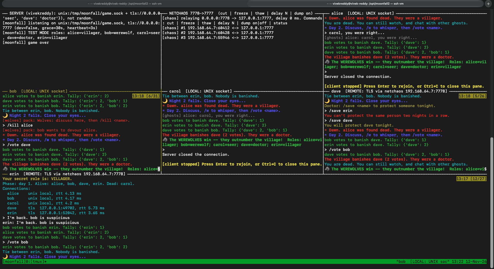
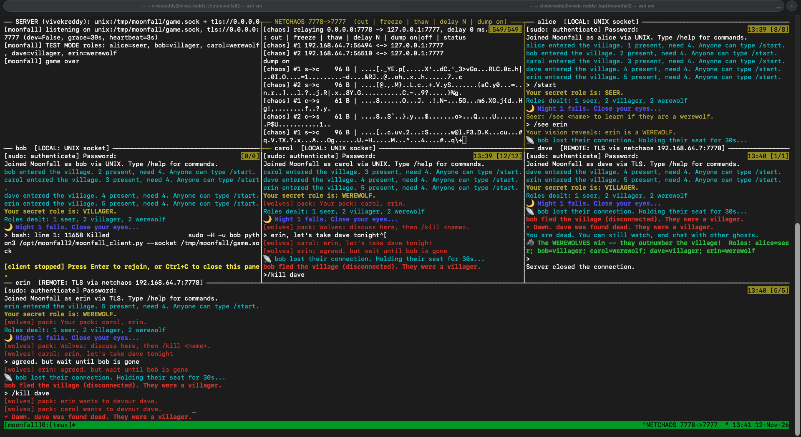
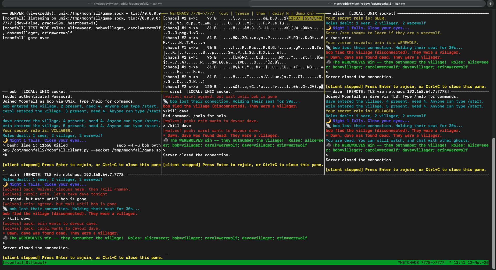
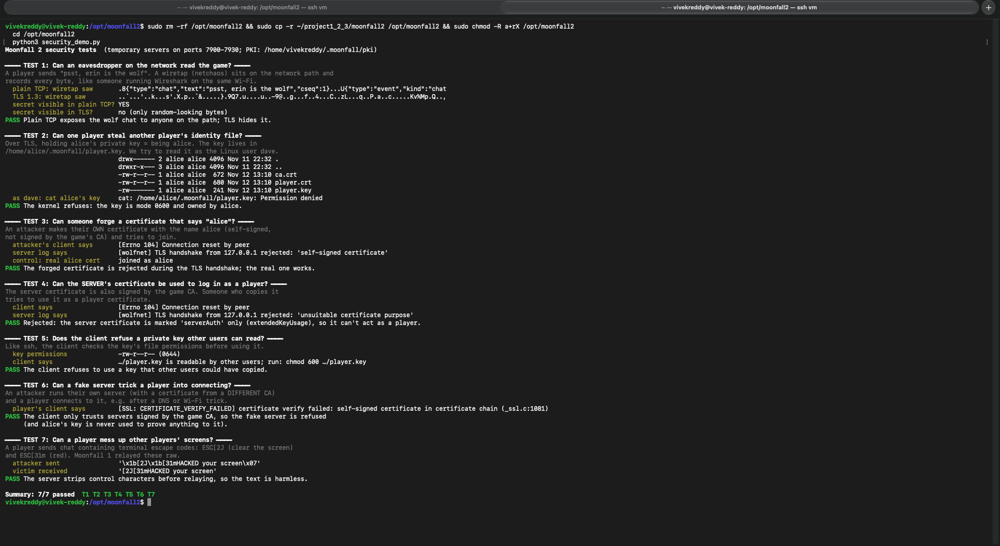

# Moonfall 2: a distributed Werewolves-like game

This is the Project #2/#3 version of my Project #1 game,
[Moonfall](https://github.com/vivekreddy1105/moonfall).

Project 1 ran on one machine over UNIX domain sockets. Moonfall 2 lets players join from other
machines over TCP with mutual TLS 1.3. The game also keeps working through network problems,
such as dropped connections, silent (half-open) links and crashed clients, without losing or
duplicating any message.

**Communications library:** `wolfnet.py`, a single file at the top level of this repo. All
communication between the server, clients and bots goes through it.

**Feedback wanted:** please see [Try to break it](#try-to-break-it) at the end.


The panes are: the server, a network simulator, three local players (UNIX socket) and two
remote players (TLS). Each player is a different Linux user.

## What changed since Project 1

| | Project 1 | Moonfall 2 |
|---|---|---|
| Where players can be | same machine | same machine or another machine |
| Transport | UNIX socket | UNIX socket and TCP + TLS 1.3, at the same time |
| Identity | `SO_PEERCRED` (Linux user) | `SO_PEERCRED` locally; a client certificate signed by the game's CA remotely |
| Connection drops | player leaves the game | seat held for 30 s while the client reconnects automatically |
| Messages during a reconnect | n/a | delivered exactly once and in order, in both directions |
| Silent dead link | n/a | detected by heartbeats after about 9 s |
| Client crash | player gone | restart within 30 s to get the seat and role back |
| Terminal escape codes in chat | passed through (bug) | removed by the server |

The game logic doesn't know whether a player is local or remote.

## The game

The server deals secret roles to 4 or more players:

| Role | Night action |
|---|---|
| Werewolf (1 per 4 players) | `/kill <name>`, agreed with the other wolves in a private chat |
| Seer | `/see <name>` to learn whether that player is a werewolf |
| Doctor (5+ players) | `/save <name>`, but not the same person two nights in a row |
| Villager | none |

- **Night:** only werewolves can talk, in their private channel.
- **Day:** everyone talks, can whisper with `/w`, and votes with `/vote`. The most votes is
  banished; a tie banishes nobody. Others can see that a whisper happened, but not what it said.
- **Dead players** can only talk to other dead players.
- **Who wins:** the village wins when all werewolves are dead. The werewolves win when they
  equal or outnumber everyone else.
- **Phase length:** a phase ends when everyone has acted, or after 5 minutes (night) or
  10 minutes (day).

## Setup

**Requirements:** Ubuntu (tested on 26.04), Python 3.11+, `tmux` and `openssl`. There are no
packages to install.

### Full game (several Linux users, local and remote players)
```bash
git clone https://github.com/vivekreddy1105/moonfall2.git
sudo cp -r moonfall2 /opt/moonfall2 && sudo chmod -R a+rX /opt/moonfall2
cd /opt/moonfall2
sudo ./setup_users.sh       # creates users alice..erin and a certificate for each
./play_tmux.sh
```
Once everyone has joined, type `/start` in any player pane.

| Pane | What it is |
|---|---|
| SERVER | the game server, on the UNIX socket and on TLS port 7777 |
| NETCHAOS | a network simulator between the remote players and the server |
| alice, bob, carol | local players on the UNIX socket |
| dave, erin | remote players over TLS, through NETCHAOS |

**Options:**
- Fixed roles, for testing: `ROLES=dave=werewolf,alice=seer,erin=doctor ./play_tmux.sh`
- Choose who is local and who is remote: `LOCAL="alice bob" REMOTE="carol dave erin" ./play_tmux.sh`
- Restart: `tmux kill-session -t moonfall && ./play_tmux.sh`

**Things to try during a game:**
- In NETCHAOS, type `cut`. The remote players reconnect, and everyone is told.
- Type `freeze`, then quickly `/vote` as dave. After about 9 s the dead link is detected,
  dave reconnects, and his vote arrives once.
- Type `delay 150`, wait a few seconds, then `/who`. The remote players' round-trip time goes up.
- Type `dump on`, then chat as dave. The relayed bytes are unreadable.
- Kill a player's client: `sudo pkill -KILL -u erin -f moonfall_client.py`. Press Enter in
  erin's pane within 30 s and she gets her seat and role back. Otherwise she leaves the game.

### Quick test as one user (no sudo)
```bash
python3 moonfall_pki.py init && python3 moonfall_pki.py server && python3 moonfall_pki.py player alice bob carol dave erin
DEV=1 ./play_tmux.sh
```

### Joining from another machine
1. **On the server machine:** `python3 moonfall_pki.py player frank && python3 moonfall_pki.py bundle frank`
2. **Copy** `frank-moonfall.tgz`, `wolfnet.py` and `moonfall_client.py` to the other machine.
3. **On the other machine:**
   ```bash
   tar xzf frank-moonfall.tgz -C ~ && chmod 700 ~/.moonfall
   python3 moonfall_client.py --server tls://SERVER_IP:7777
   ```

The server certificate lists the server's IP addresses. If the IP changes, run
`python3 moonfall_pki.py server` again.

## Commands

| Command | What it does |
|---|---|
| `<text>` | chat (day: everyone; night: werewolves only; dead: dead players only) |
| `/w <name> <text>` | whisper (day) |
| `/vote <name>` | vote to banish (day) |
| `/kill`, `/see`, `/save <name>` | night actions for the werewolf, seer and doctor |
| `/who` | players, and each player's connection type, address and round-trip time |
| `/net` | your own connection statistics |
| `/start` | start the game |
| `/help`, `/quit` | help; leave the game |

## The communications library: `wolfnet.py`

`wolfnet.py` is a single file that uses only the Python standard library (`asyncio`, `ssl`,
`socket`). The server, client and bot import it, and none of them open sockets themselves.

### Addresses
| Address | Transport | How the server knows who you are |
|---|---|---|
| `unix:/tmp/moonfall/game.sock` | UNIX socket | `SO_PEERCRED`, giving the Linux user name |
| `tls://host:7777` | TCP + TLS 1.3, client certificate required | the name in the certificate, which must be signed by the game's CA |
| `tcp://host:port` | plain TCP, only with `--dev` | a nickname (used only to show why TLS is needed) |

A server can listen on several addresses at once.

### Server API
```python
srv = Server(listen, on_join, on_message, on_leave, *, dev=False,
             tls=(cert, key, ca), grace=30, heartbeat=3, on_away=None, on_back=None)
await srv.start();  await srv.close()
srv.send(name, msg)                    # to one player
srv.multicast(group, msg, exclude=())  # to a group, e.g. "wolves", "ghosts"
srv.broadcast(msg, exclude=())         # to everyone
srv.join_group(name, group);  srv.leave_group(name, group);  srv.members(group)
srv.kick(name, reason)
srv.info(name)                         # connection state, transport, address, round-trip time
```
- **Callbacks:** `on_join(name)`, `on_message(name, msg)`, `on_leave(name)`.
- **New callbacks:** `on_away(name)` and `on_back(name, info)`, called when a connection drops
  and when the player comes back.

### Client API
```python
c = Client("tls://host:7777", cert=..., key=..., ca=..., reconnect=True, on_link=callback)
name = await c.connect()            # the name assigned by the server
await c.send("chat", text="hello")  # resent after a reconnect if needed
msg = await c.recv()                # a dict, or None when the session ends
await c.close()
```
`on_link(state, info)` is called with `"down"`, `"up"` or `"lost"`.

### Message format
Each message is a 4-byte length followed by a JSON object with a `"type"` field, up to 64 KB.
This is the same as Project 1.

New in Moonfall 2:
- **Sequence numbers.** Every server message has a `seq` number and every client message a
  `cseq` number. Both sides use them to replay missed messages and drop duplicates.
- **Heartbeats.** The server sends `ping` every 3 seconds and the client answers `pong`. These
  also carry acknowledgements and measure the round-trip time.
- **Login and resume.** `hello` carries a session token and the last message received, so a
  reconnecting client can resume its session. `bye` means the player left on purpose.

### What happens when a connection drops
1. The link fails with an error, or goes silent for 3 heartbeats.
2. The server marks the player as away, keeps their seat for 30 seconds, and stores their
   messages.
3. The client reconnects and sends its session token and the number of the last message it got.
4. The server checks the player's identity and the token, then sends the missed messages. The
   client resends anything the server didn't receive. Duplicates are dropped on both sides.
5. If the player doesn't return within 30 seconds, they are removed from the game.

### Where each kind of message is used
| Kind | Used for |
|---|---|
| Unicast | roles, seer results, doctor confirmations, whispers, errors, `/who` |
| Multicast | werewolf chat and dead players' chat (members can be on different transports) |
| Broadcast | day chat, votes, deaths, phase changes, connection notices, game over |

### Security
- **Identity can't be faked.** It comes from the kernel (UNIX) or from a certificate signed by
  the game's CA (TLS), and the server sets the sender of every message.
- **Keys belong to Linux users.** Each player's private key is in `~player/.moonfall/` with mode
  0600. The client refuses to use a key other users can read.
- **Certificates are checked both ways.** The client checks the server's certificate, so a fake
  server is refused. Player and server certificates are marked for different uses, so neither
  can be used as the other.
- **Resuming needs both** the session token and the same identity.
- **Limits on the open port:**
  - 10-second login timeout;
  - at most 64 connections in total, and 8 not-yet-logged-in connections per IP;
  - 10 messages per second per player.
- **Control characters are removed** from all player text.

## Testing

Two test tools come with the game:
- **`netchaos.py`** simulates network problems without root: `cut`, `freeze`, `delay N`,
  `dump on`. It is a test tool, not part of the game's communications.
- **`security_demo.py`** runs 7 attacks against temporary servers and prints PASS or FAIL.

| Test | Result |
|---|---|
| Connection cut | remote players reconnected in 0.01–0.03 s; missed messages were replayed |
| Frozen (silent) link | detected after 9 s; messages typed during the freeze were delivered once |
| 100 messages each way, across a freeze and a cut | all 100 delivered, in order, no duplicates |
| 150 ms added delay | round-trip time 307 ms for TLS players vs 1.4 ms for local players |
| Client killed and restarted within 30 s | seat and role restored |
| `security_demo.py` | 7 of 7 passed |

## Screenshots

| Screenshot | What it shows |
|---|---|
|  | Game 1: night actions, a whisper, then a cut and a freeze. The remote players reconnect. |
|  | `/who` with 150 ms delay: 307 ms for TLS players, 1.4 ms for local players. |
|  | Game 1 ends: the werewolf is voted out. |
|  | Game 2: erin's client is killed. Pressing Enter rejoins, and her role is sent again. |
|  | Game 2: a tied vote, so nobody is banished. |
|  | Game 2 ends: the werewolf wins. |
|  | Game 3: one werewolf is local and one remote, sharing one chat. The relayed traffic is unreadable. |
|  | Game 3: bob doesn't come back within 30 s and is removed. |
|  | `security_demo.py`: all 7 attacks fail. |

## Files

| File | Purpose |
|---|---|
| `wolfnet.py` | **the communications library** |
| `moonfall_server.py` | game server |
| `moonfall_client.py` | player program |
| `moonfall_bot.py` | bot player |
| `moonfall_pki.py` | creates the certificates |
| `setup_users.sh` | creates the player accounts and installs their certificates |
| `play_tmux.sh` | starts a game in tmux |
| `netchaos.py` | network simulator (test tool) |
| `security_demo.py` | security tests |
| `screenshots/` | screenshots |

## Try to break it

The game now has an open TCP port, which is a bigger target than Project 1's socket file.
Please try any of these and tell me what happened, even if nothing broke:

1. **Join as someone else:** forge a certificate, reuse a session token, or connect twice.
2. **Overload port 7777:** open many connections that never finish the TLS handshake, or flood
   messages. Can the others still play?
3. **Make a message count twice or go missing:** send odd `cseq` values, or reconnect over and
   over.
4. **Abuse the 30-second grace period:** stall the game or avoid a vote.
5. **Learn secrets from traffic:** can message sizes or timing reveal who the werewolves are?
6. **Crash the server or client:** send bad data before or after the TLS handshake.

Report by opening a GitHub issue or replying to my Canvas post.

**Raw TLS starting point** (create certificates first with the quick test above, then run this
from `~/.moonfall/pki`):
```python
import socket, ssl, struct, json
ctx = ssl.create_default_context(cafile="ca.crt"); ctx.load_cert_chain("players/alice.crt", "players/alice.key")
s = ctx.wrap_socket(socket.create_connection(("127.0.0.1", 7777)), server_hostname="127.0.0.1")
send = lambda m: s.sendall(struct.pack("!I", len(d := json.dumps(m).encode())) + d)
send({"type": "hello", "proto": 2}); print(s.recv(4096))
```

### Known limitations
- A stolen key can't be revoked; it works until it expires (1 year).
- There is one server and the game isn't saved, so if the server stops, the game ends.
- NETCHAOS simulates connection problems, not packet loss (TCP already hides packet loss).
- Clients must connect with an address listed in the server certificate.
